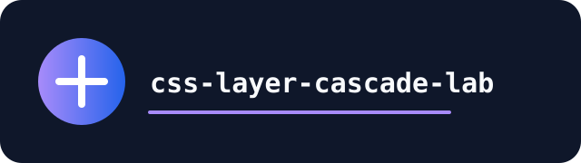

<p align="center"></p>
<p align="center"></p>
<p align="center">   </p>
<p align="center"></p>

## 🧭 Overview

`css-layer-cascade-lab` makes CSS cascade layers visible. It applies the same selector in three named layers, lets you reorder their precedence, and displays the browser-computed result so you can see that layer order is resolved before selector specificity across layers.

## ✨ Features

- 🎚️ Switch between several layer-precedence orders
- 🧪 Keep selectors equally specific to isolate layer ordering
- 🔍 Read computed background, text color, and border values
- 🧠 See the active `@layer` order declaration
- 🔒 Runs locally with no external requests or dependencies

## 🧪 Demo

Start the local server and open `http://127.0.0.1:4173`. Use **Change layer order** and compare the preview and computed-style panel. No hosted demo is published.

## 🚀 Quick Start

```bash
npm start
```
Open `http://127.0.0.1:4173` in a modern browser. Node.js 18 or newer is required; there are no npm dependencies.

## 🧰 Tech Stack

- **Stack:** Node.js built-in HTTP server, HTML, CSS Cascade Layers, and browser JavaScript
- **Approach:** small, local-first tooling with clear output

## 🗂️ Folder Structure

```text
css-layer-cascade-lab/
├── assets/mark.svg
├── public/index.html
├── public/styles.css
├── public/app.js
├── server.js
├── package.json
├── .gitignore
├── LICENSE
└── README.md
```

## 🛣️ Roadmap

- Add a specificity comparison inside a single layer
- Export the current layer-order declaration as CSS

## 🤝 Contributing

Issues and focused pull requests are welcome. Explain the use case, keep changes small, and add tests for behavior changes. Run the project using the Quick Start instructions before submitting.

## 📄 License

Released under the [MIT License](LICENSE).

<p align="center"></p>
